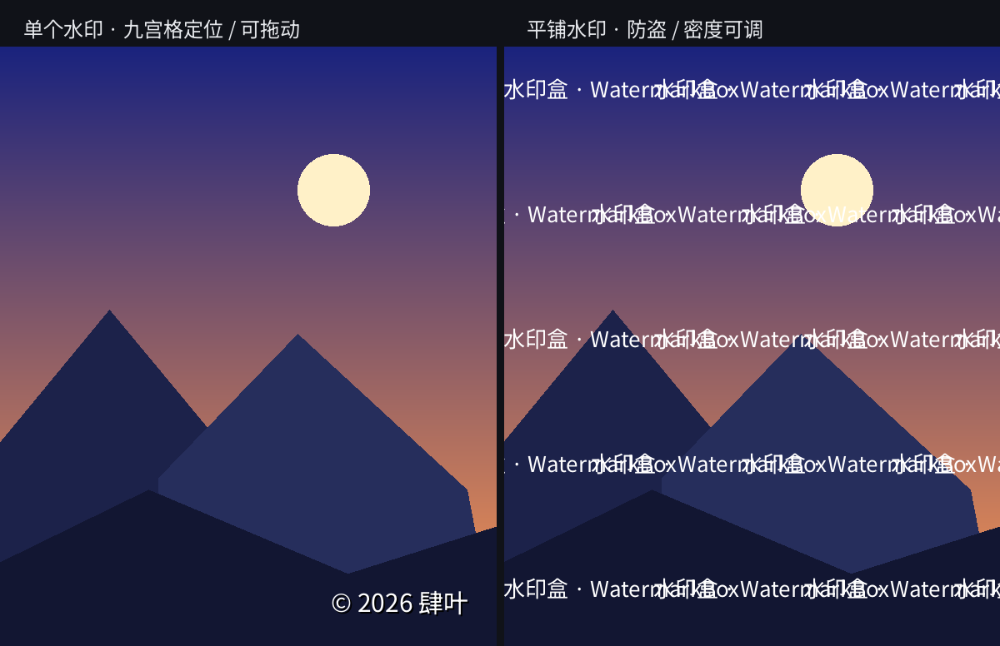
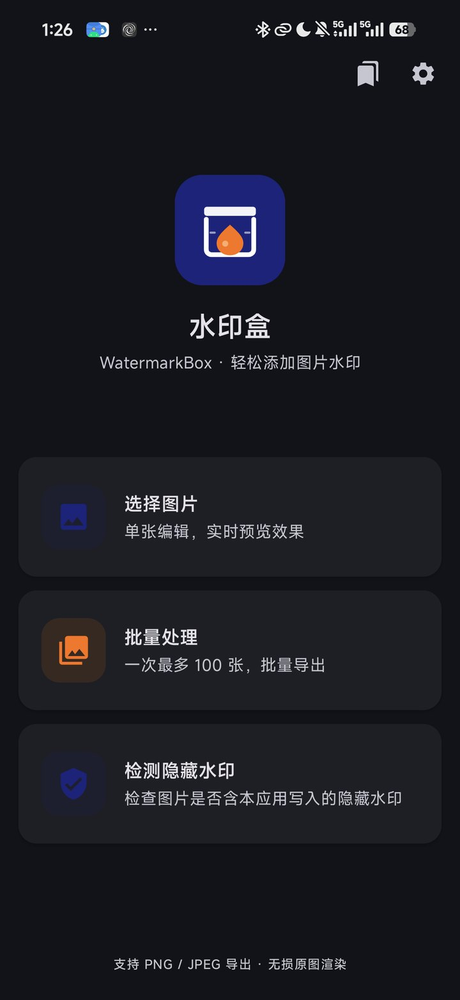
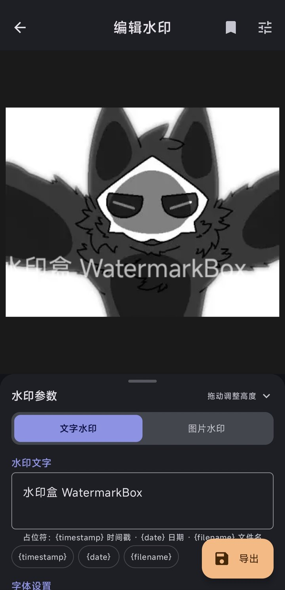
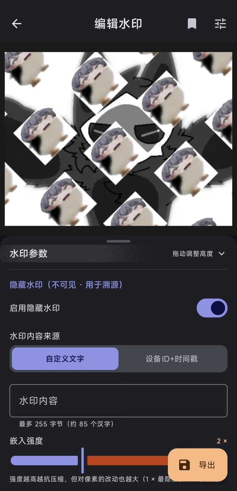
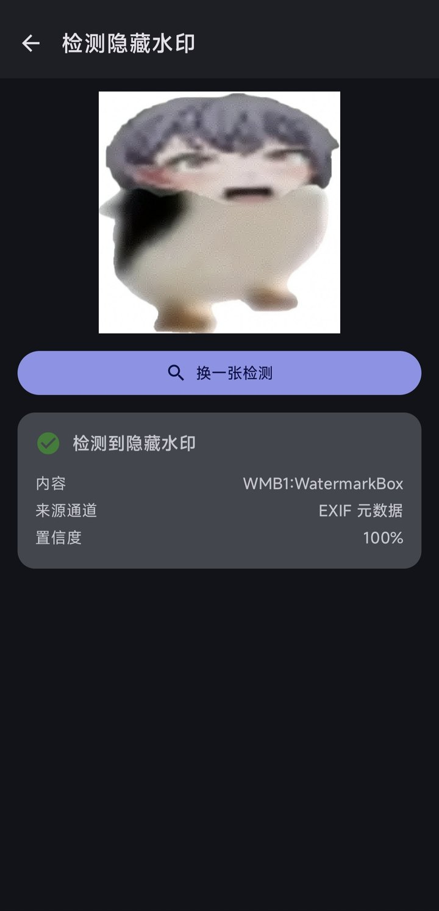
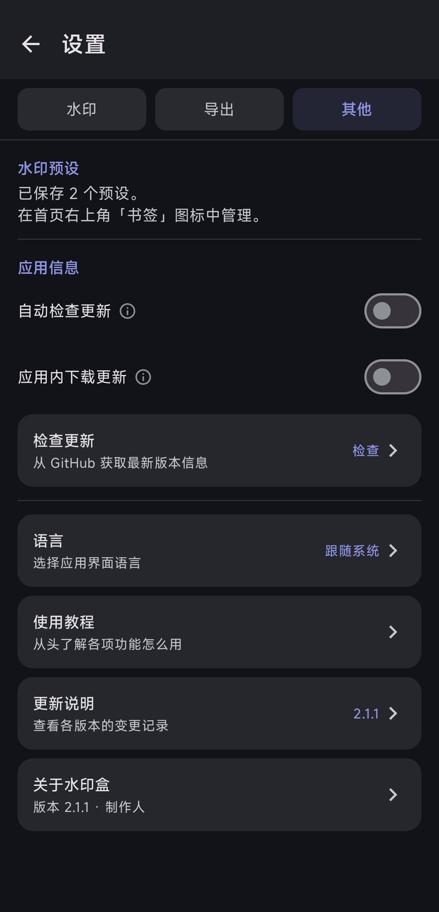

<div align="center">


<br>



<sub>Left: a single watermark (9-grid anchor, or drag it right on the preview)　·　Right: tiled watermark (anti-repost)</sub>

<br>
<br>

[](LICENSE)
[](https://developer.android.com)
[](https://kotlinlang.org)
[](https://developer.android.com/jetpack/compose)

[](https://github.com/Si-Ye/WatermarkBox/releases/latest)
[](https://github.com/Si-Ye/WatermarkBox/actions/workflows/build.yml)
[](https://github.com/Si-Ye/WatermarkBox/releases/latest)

[**中文文档**](README.md)　·　**English**

<br>

<a href="https://github.com/Si-Ye/WatermarkBox/releases/latest"><b>⬇ Download latest</b></a>　|　
<a href="docs/releases">Changelog</a>　|　
<a href="#architecture">Architecture</a>

</div>

---

> This is a condensed English version. The full documentation — including
> a detailed **development journal** with seven real bug post-mortems — is in
> [**README.md**](README.md) (Chinese).

---

## What is this

An Android app for adding watermarks to images. Text or logo, single or tiled —
you see the result while you tune it, instead of finding out after export.

But it does one more thing: **invisible watermarks**.

You can embed a string — say `© 2026 Si-Ye`, or a device ID — into an image.
**The picture looks completely unchanged**, but the payload can be extracted later.
If the image gets reposted somewhere, you can trace where it came from.

It is built for illustrators, photographers, and anyone who worries about
their work being reused without credit.

---

## Screenshots

<div align="center">

| Home | Editor · Text | Editor · Invisible |
|:---:|:---:|:---:|
|  |  |  |

| Detect | Settings |
|:---:|:---:|
|  |  |

<sub>The detection screen shows a real result: the payload was recovered from an
image, with 100% confidence.</sub>

</div>

---

## Features

### Single-image editing

- **Photo Picker** — no storage permission required
- **Live preview** — every parameter change redraws immediately
- **Text watermark** — size 6–300, font family, **custom font import** (ttf/otf),
  color, bold, italic, outline, shadow
- **Image watermark** — width ratio, aspect-ratio lock, opacity
- **Layouts** — single / tiled / diagonal
- **Drag to position** — in single mode, drag the watermark **directly on the
  preview** instead of being limited to a 3×3 grid; tapping a grid cell still
  snaps it back to a tidy anchor
- **Export** — PNG (lossless) or JPEG (adjustable quality)

### Batch processing

- Up to **100 images** per run
- **Identical UI to single mode** — the same parameter panel, reused
- Swipe the preview to move between images; an "add more" entry sits at the end
- Runs on WorkManager in the background, with live progress and cancel support
- One failure does not abort the batch; a summary is shown at the end

### Presets

- Persisted via DataStore — survives restarts
- **Editable without an image** — you can tweak parameters before picking one
- Saving under an existing name asks first: keep both / replace / cancel.
  It never silently overwrites.
- **Export to a file / import from a file** — for backup and sharing. Duplicate
  names are renamed on import, so existing presets are never overwritten.

### Invisible watermark

| Channel | Carrier | Visual impact | Survives compression |
|---|---|---|---|
| L1 | Metadata: EXIF `UserComment` + **XMP** | **None** (pixels untouched) | ❌ Gone after any re-encode |
| L2 | DCT mid-band coefficients | Peaks at ±40/255, average < 5 | ✅ Survives JPEG 80–90 |

Both channels can be **switched on and off independently**. Metadata is the *overt* path — precise but
fragile; DCT is the *covert* path — fuzzy but stubborn.

**Measured** (512×512 test image):

- Bit accuracy **97%** (3994 / 4096)
- Survives JPEG quality **90 / 80**
- Survives **two consecutive re-encodes** (90 → 85)
- Survives a lossless PNG round-trip

**And what it cannot do** — this part matters:

- ❌ **Lost to screenshots or re-photographing** — no watermark scheme survives
  that; it is a physical limit
- ❌ Below JPEG quality 60 the frequency-domain channel may fail
  (if the file is not re-encoded, the EXIF copy is still there)
- ❌ Solid-color or very smooth images can carry little data

DCT costs some image quality (strength is **adaptive per block**, cutting the
worst-case change by ~70%), so the app exposes **toggles** — the trade-off is
yours to make. Right-angle rotations (90/180/270 degrees) are still detected.

### Detection

Given an image, the app reports whether it carries a payload written by this
app — with the content, the source channel, the signature state and a confidence
score. Metadata first, then the frequency domain. You can also pick what to check:
metadata only (fastest), plus frequency, all strengths, all four rotations, or
DCT-based signature verification.

Two-stage strategy: **EXIF first, frequency domain as fallback**.

---

## Architecture

```
app/src/main/java/com/watermarkbox/
├── data/
│   ├── model/          # Data models (watermark config, presets, changelog)
│   └── repository/     # ImageRepository / ExportRepository / SettingsRepository
├── invisible/          # Invisible watermark engine (DCT, Reed-Solomon, QIM — all hand-written)
├── ui/
│   ├── component/      # Reusable composables: WatermarkPreview, DraggableBottomPanel, …
│   ├── screen/         # Feature screens (home / editor / batch / presets / settings)
│   └── theme/          # Material 3 theme
├── util/               # Bitmap, EXIF, filename templates, placeholder resolution
├── watermark/          # Watermark rendering engine (text / image / tiled / diagonal)
└── worker/             # WorkManager tasks for batch processing
```

**Layering**: `MVVM + Repository + Coroutines/Flow`

- The UI layer only holds a `UiState`; every mutation goes through a
  `ViewModel` method
- Repositories own IO and persistence; the UI never touches `ContentResolver`
  directly
- The parameter panel `WatermarkPanel` talks to the ViewModel through a
  `WatermarkPanelHost` interface, which is what lets the single-editor and the
  batch screen **share the same panel**

### Invisible watermark — the interesting parts

- **Frequency selection** — only coefficients whose JPEG luminance quantisation
  step is ≤ 14 are used, avoiding "death zones" like (3,3)=22
- **Step size** — adaptive: `quantStep × 6 × luminanceFactor`, hard-capped at 60
- **Error correction** — Reed-Solomon(16,8); each block recovers up to 4 symbol
  errors
- **Redundancy** — one bit per block, with `totalBlocks / bitCount` replicas
  scattered across the image
- **Decoding** — confidence-weighted soft-decision voting
- **Self-recovery** — the decoder enumerates candidate lengths and uses CRC-16
  to pick the right one, so **no external metadata is required**

**No third-party watermark libraries** — DCT, Reed-Solomon and QIM are all
implemented from scratch.

### Tech stack

| Area | Choice |
|---|---|
| Language | Kotlin 2.3 |
| UI | Jetpack Compose + Material 3 |
| Architecture | MVVM + Repository + Coroutines/Flow |
| Navigation | Navigation Compose |
| Background work | WorkManager |
| Persistence | DataStore Preferences |
| Serialization | Kotlinx Serialization |
| Image loading | Coil |
| Minimum | Android 8.0 (API 26) / targetSdk 35 |

---

## Building

### Requirements

- JDK 17
- Android SDK (compileSdk 35, build-tools 35.0.0)

### Commands

```bash
# Unit tests (356)
./gradlew testDebugUnitTest

# Debug build
./gradlew assembleDebug
# Output: app/build/outputs/apk/debug/app-debug.apk

# Release build
./gradlew assembleRelease
# ⚠️ In arm64/proot environments this artifact may be missing AndroidManifest.xml
#    (it will not install). Use the repo's repack script instead:
#      python3 tools/build_release_apk.py
#    Always verify the artifact before publishing:
#      python3 tools/check_apk_integrity.py --require-signature app/build/outputs/apk/release/app-release.apk
```

### Release signing

Create `keystore.properties` in the project root (**this file is gitignored**):

```properties
storeFile=keystore/your-release.jks
storePassword=****
keyAlias=your-alias
keyPassword=****
```

If the file is absent, `assembleRelease` falls back to an unsigned build
rather than failing.

### Testing

```bash
./gradlew testDebugUnitTest           # Unit tests (pure JVM)
./gradlew connectedDebugAndroidTest   # Instrumented tests (needs a device)
```

Unit tests can only cover so much — anything that genuinely needs the Android
runtime goes through instrumented tests:

| Test class | Invariant it pins down |
|---|---|
| `WatermarkPayloadTest` | Payload round-trip, CRC rejects tampering, sync-word validation |
| `ReedSolomonTest` | Each block corrects 4 symbol errors; correct data is never altered |
| `DctMathTest` | **DCT ↔ IDCT are a true inverse pair**; QIM survives an IDCT round-trip |
| `BlockSelectionStabilityTest` | Selection criteria agree before/after embedding; position order is reproducible |
| `MidBandSelectionTest` | Only low-quantisation frequency points are chosen |
| `EnginePureSimulationTest` | **End-to-end in pure JVM**: embed → vote → RS decode |
| `AppLicenseTest` | License constants agree; repo URL and displayed text point at the same place |
| `InvisibleWatermarkInstrumentedTest` | On-device JPEG 90/80/two-round, PNG round-trip, pixel-delta stats |

### Pre-push audit

The repo ships a secret scanner to catch accidental commits before they are
pushed:

```bash
sh tools/pre_push_audit.sh            # working tree + commits to be pushed
sh tools/pre_push_audit.sh --staged   # staged changes only (fast pre-commit check)
```

It covers five categories:

1. **Dangerous files** — signing keys, APKs, build output, local config
2. **Credentials** — hard-coded passwords, GitHub tokens, cloud keys
3. **Local paths & private networks** — leaking directory layout or intranet topology
4. **Build portability** — e.g. `gradle-wrapper.properties` pointing at a local file
5. **`.gitignore` completeness** — are the key exclusions all present

Exit code `0` means clean, `1` means problems were found — suitable for CI gates.

The scanner's own rule patterns would match themselves, so it excludes itself.
There is also a regression test for the rules:

```bash
sh tools/test_audit_rules.sh   # 14 scenarios: must-block / must-allow
```

> Both scripts live in `tools/`. A git `pre-commit` hook can run the audit
> automatically — install it with `sh tools/install_hooks.sh`.

### Release automation

Two GitHub Actions workflows:

| Workflow | Trigger | What it does |
|---|---|---|
| [Build](.github/workflows/build.yml) | push to `main` / PR | Unit tests, **Android Lint**, debug + release compile |
| [Release](.github/workflows/release.yml) | tag push (`v*`) | Signs the APK, creates a GitHub Release, uploads the APK |

Lint is enforced with a **baseline** (`app/lint-baseline.xml`): pre-existing
warnings are frozen, so only *new* issues fail the build.

---

## Privacy

- **No network calls** except the opt-in update check against the GitHub API
  (and it can be turned off entirely)
- **No analytics, no ads, no accounts**
- Photos are processed on-device; nothing is uploaded

---

## License

Apache-2.0 — see [LICENSE](LICENSE).

---

<div align="center">

<br>


<br>

**WatermarkBox**　`v2.0.1`

Made with 🐺 by [Si-Ye](https://github.com/Si-Ye)

<br>

[中文文档](README.md)　·　[English](README.en.md)　·　[Download](https://github.com/Si-Ye/WatermarkBox/releases/latest)　·　[Changelog](docs/releases)　·　[Issues](https://github.com/Si-Ye/WatermarkBox/issues)

<br>

<sub>Apache-2.0 License · Collects no data · Downloads only, never uploads</sub>

<br>
<br>

</div>